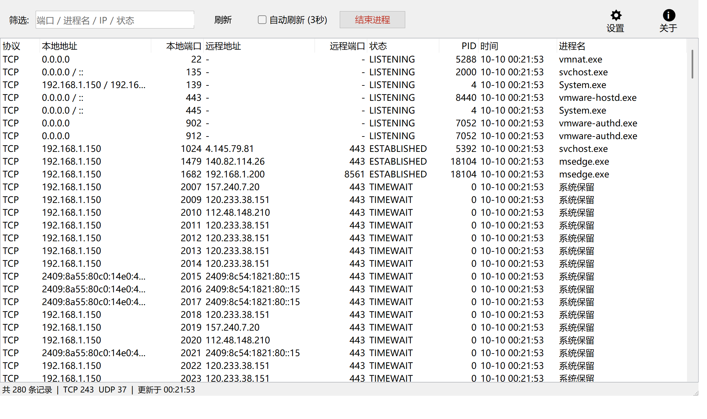
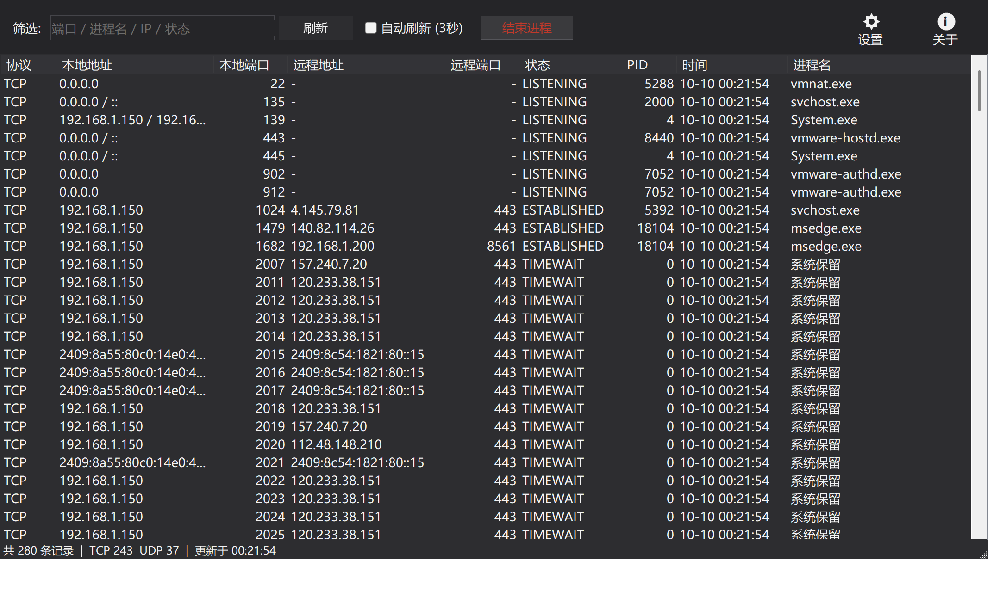
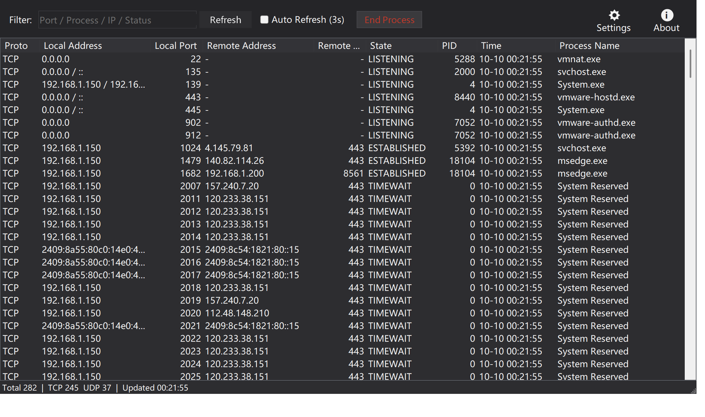
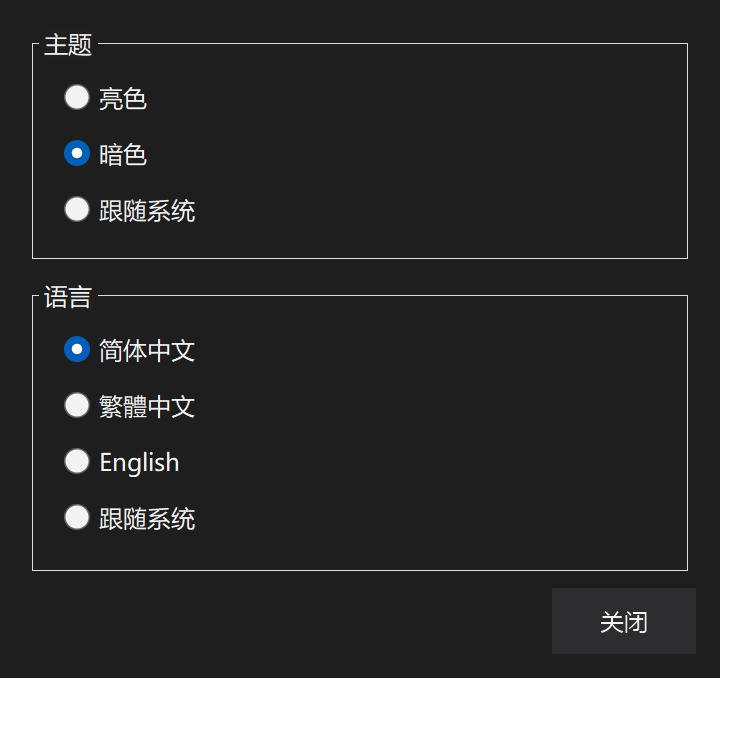
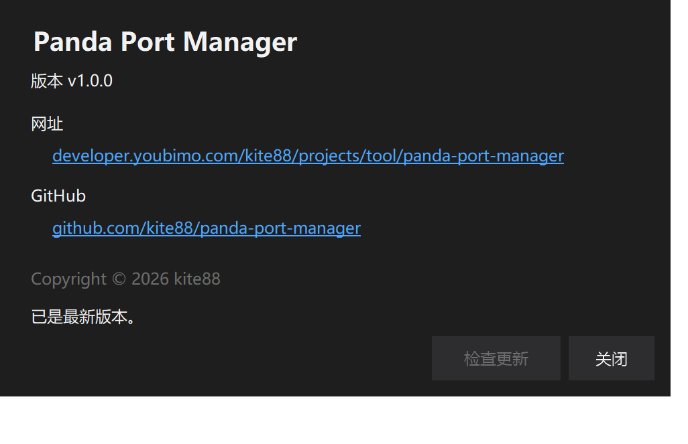

[简体中文](README.md) | **繁體中文** | [English](README.en.md)

<p align="center">
  
</p>

# 熊貓埠管理器 · Windows 埠占用管理工具

[](https://github.com/kite88/panda-port-manager/releases/latest)
[](LICENSE)

一個 Windows 桌面小工具（WinForms / .NET 10），把「誰佔了這個埠」這件事變成一眼可見：列出全部
TCP / UDP 埠占用及其程序，篩選、排序、一鍵結束程序釋放埠；還能識別 winnat 系統保留埠
（Hyper-V / WSL / Docker 佔用的「無主」埠）並一鍵釋放。單檔案 exe、開箱即用，支援中英雙語與
亮暗主題。

## 截圖

**亮色主題（簡體中文）**



**暗色主題（簡體中文）**



**暗色主題（English）**



**設定彈窗（暗色）**



**關於彈窗（版本號與官網 / GitHub 連結）**



## 功能特性

- **埠全景**：列出全部 TCP / UDP 埠占用，包含協議、本地地址 / 埠、遠端地址 / 埠、
  連線狀態、PID、程序名，以及「時間」列（該條目首次被發現的時間，用於觀察新建連線）。
- **IPv4 / IPv6 雙棧合併**：同一程序在同一埠上的 v4 與 v6 監聽合併為一行，位址列顯示
  `0.0.0.0 / ::`，不再重複刷屏。
- **實時篩選**：按埠 / 程序名 / IP / 狀態即時過濾，邊輸邊篩。
- **排序**：點選任意列頭排序，埠、PID 等數字列按數值比較（不會出現 10 排在 9 前面）。
- **結束程序**：支援單選、多選批次結束（含子程序樹）；也可在列表上右鍵操作，或直接按
  `Delete` / `Enter`。系統關鍵程序受系統保護，結束失敗會明確提示。
- **自動重新整理**：預設手動，勾選後每 3 秒自動重新整理；重新整理會保持篩選結果、排序與選中行不變。
- **系統保留埠識別與釋放**：對沒有程序的埠，自動查詢 `netsh` 的排除埠範圍；若命中
  winnat 保留段（通常由 Hyper-V / WSL / Docker 保留），可一鍵重啟 winnat 服務釋放該範圍。
- **主題**：亮色 / 暗色 / 跟隨系統，暗色含標題欄（DWM）、列表表頭、彈窗與右鍵選單的完整適配。
- **三語介面**：簡體中文 / 繁體中文 / English 即時切換，也可選「跟隨系統」（繁體地區如臺灣 / 香港 /
  澳門用繁體中文，其餘中文用簡體，非中文系統用 English）。
- **高 DPI 多屏適配**：基於 `PerMonitorV2` 並手工縮放，跨不同 DPI 的螢幕拖動時工具欄、按鈕、列寬與
  字號按新 DPI 絕對重算（框架自身的縮放結果會被覆蓋、絕不疊加），文字不會被裁切或忽大忽小。
- **設定 / 關於按鈕**：工具欄右側「設定」「關於」圖示按鈕（圖示 + 文字）。設定開啟彈窗切換
  主題與語言；關於彈窗顯示版本號，並附
  [官網](https://developer.youbimo.com/projects/tool/panda-port-manager) 與
  [GitHub](https://github.com/kite88/panda-port-manager) 連結，點選即在瀏覽器開啟。
- **設定持久化**：主題與語言儲存在 `%LOCALAPPDATA%\PandaPortManager\settings.json`，即點即生效。

## 下載與執行

從 [Releases](https://github.com/kite88/panda-port-manager/releases/latest) 下載對應架構的包：

- `PandaPortManager-win-x64.zip`：64 位 Intel/AMD（最常見）
- `PandaPortManager-win-x86.zip`：32 位 x86
- `PandaPortManager-win-arm64.zip`：ARM64（如驍龍筆記本）

解壓後得到 `PandaPortManager.exe`，雙擊執行即可。

- 系統要求：Windows 10 / 11，[.NET 10 Desktop Runtime](https://dotnet.microsoft.com/download/dotnet/10.0)。
- 程式清單宣告瞭 `requireAdministrator`，啟動時會彈出 UAC 提權確認——結束其他使用者的程序、
  系統程序以及重啟 winnat 都需要管理員許可權。
- 解除安裝即刪：程式是單檔案，不寫登錄檔，唯一的落盤資料是上面提到的 settings.json。

## 使用說明

1. **找埠**：在篩選框輸入埠號（如 `8080`）、程序名、IP 或狀態（如 `LISTENING`）。
2. **看程序**：「程序名」列即佔用者；PID 為 0 且顯示「系統保留」的條目沒有對應程序。
3. **釋放埠**：選中一行（或多行）後點紅色「結束程序」按鈕、右鍵選「結束程序」，或按
   `Delete` / `Enter`，確認後即結束程序並釋放埠。
4. **釋放保留埠**：對「系統保留」的埠點「結束程序」，若埠在 winnat 保留範圍內會詢問
   是否重啟 winnat 服務（期間 WSL / Docker / NAT 網路可能短暫中斷）。
5. **主題與語言**：點選右上角「設定」圖示按鈕開啟設定彈窗，切換主題（亮色 / 暗色 / 跟隨系統）
   與語言（簡體中文 / 繁體中文 / English / 跟隨系統），即點即生效並自動儲存。

狀態列實時顯示：記錄總數、TCP / UDP 各多少條、最後更新時間。

## 從原始碼構建

需要 .NET 10 SDK（`net10.0-windows`）。

```powershell
# 編譯
dotnet build PandaPortManager -c Release

# 釋出單檔案 exe（依賴目標機安裝 .NET 10 Desktop Runtime）
dotnet publish PandaPortManager -c Release -r win-x64 `
  -p:PublishSingleFile=true -p:SelfContained=false -o dist
```

### 一鍵釋出多架構（x64 / x86 / arm64）

倉庫根目錄的 `publish.ps1` 可一次性打出三套單檔案包（依賴框架釋出，需目標機已裝
.NET 10 Desktop Runtime）；加 `-SelfContained` 則打包為自帶執行時的綠色單檔案：

```powershell
.\publish.ps1                 # 依賴框架
.\publish.ps1 -SelfContained   # 自帶執行時（免裝 .NET，體積更大）
```

產物分別位於 `publish/win-x64`、`publish/win-x86`、`publish/win-arm64`。

### 發版

推 `v*` 標籤即可，workflow（`.github/workflows/release.yml`）會在 Windows runner 上自動編譯、
釋出單檔案 exe、生成 SHA256 校驗和並建立 GitHub Release：

```bash
git tag v1.0.0 && git push origin v1.0.0
```

標籤名含 `-`（如 `v1.1.0-rc1`）會自動標記為 prerelease，不會頂掉 Latest。

## 實現要點

- **埠資料不靠解析 netstat 文字**：連線與監聽列表來自 `IPGlobalProperties`
  （`GetActiveTcpListeners` / `GetActiveTcpConnections` / `GetActiveUdpListeners`），欄位可靠；
  只有 PID 這一項該 API 拿不到，才退回解析一次 `netstat -ano`，按
  `協議|本地地址|本地埠|遠端埠|狀態` 把 PID 對映回條目。舊版 netstat 把 TIME_WAIT 輸出成
  帶空格的 `TIME WAIT`，解析時做了歸一。
- **重新整理不閃爍、不丟上下文**：重新整理全程 `BeginUpdate/EndUpdate`，並記住篩選詞、排序狀態與選中行
  （按五元組 + 狀態匹配恢復選中），「時間」列用首次發現時間而不是重新整理時間，因此不會每次重新整理被重置。
- **保留埠判定用系統口徑**：直接解析 `netsh interface ipv4 show excludedportrange` 的輸出區間，
  與系統「排除埠範圍」完全一致，而不是硬編碼常見段。
- **暗色不是簡單換背景**：除了控制元件配色，還處理了 DWM 暗色標題欄（`DWMWA_USE_IMMERSIVE_DARK_MODE`）、
  自繪 ListView 暗色表頭，以及 Professional 渲染器預設忽略 `ForeColor` 的右鍵選單
  （自定義 Renderer 強制生效）。
- **工具欄圖示是程式碼畫的**：GDI+ 多邊形齒輪與圓圈「i」+ 下方文字，不用任何圖片資源。
- **設定讀寫容錯**：settings.json 解析失敗時靜默回退預設值（跟隨系統主題 / 跟隨系統語言），不會崩潰。

## 已知侷限

1. 僅 Windows（WinForms），且 `requireAdministrator` 使每次啟動都有一次 UAC 確認；只看不殺的
   場景其實不需要管理員許可權。
2. 結束程序是對 PID 的強殺（`Kill(entireProcessTree: true)`），沒有「僅斷開連線」或優雅關閉選項。
3. 重新整理透過 `netstat -ano` 子程序拿 PID，機器上連線數極多時該步驟耗時隨之增長（已限制 5 秒超時）。

## 目錄結構

```text
panda-port-manager/
├── .github/workflows/release.yml   # 推 v* 標籤自動發版
├── images/                         # README 截圖
├── PandaPortManager/
│   ├── PandaPortManager.csproj     # net10.0-windows / WinForms / 單檔案釋出
│   ├── Program.cs                  # 入口
│   ├── Localization.cs             # Language 列舉 + R 文案表（簡/繁/英）
│   ├── ListViewExtensions.cs       # ListViewItem.SubCells()（整行文字拼接）
│   ├── Forms/
│   │   ├── MainForm.cs             # 主窗體骨架：控制元件欄位、構造、Load
│   │   ├── MainForm.Layout.cs      # DPI 縮放與工具欄/篩選框佈局
│   │   ├── MainForm.Theme.cs       # 明暗調色盤、DWM 暗色標題欄、表頭自繪
│   │   ├── MainForm.Controls.cs    # 自繪按鈕、工具欄圖示、雙緩衝列表、排序器
│   │   ├── MainForm.Ports.cs       # 埠掃描、netstat PID 對映、篩選
│   │   ├── MainForm.Actions.cs     # 結束程序、winnat 保留埠釋放、列排序
│   │   ├── MainForm.Dialogs.cs     # 設定 / 關於彈窗
│   │   ├── MainForm.Updates.cs     # GitHub Releases 更新檢測
│   │   └── MainForm.Settings.cs    # 設定持久化、主題/語言切換
│   └── app.manifest                # requireAdministrator（啟動時 UAC 提權）
├── PandaPortManager.slnx
└── LICENSE                         # MIT
```

> `MainForm` 用 `partial class` 按職責拆分：檔案之間共享同一份私有欄位（控制元件、主題色、
> DPI 基準值），沒有為了拆檔案而引入額外的抽象層或改變任何介面行為。

## 許可證

[MIT](LICENSE)
